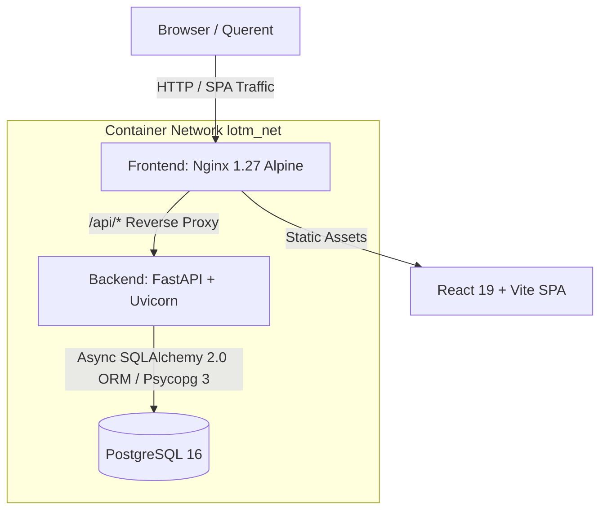

<div align="center">

# 🌙 Lord of the Mysteries — Tarot Oracle

**An immersive Victorian Backlund tarot divination portal inspired by *Lord of the Mysteries***

[](https://www.python.org/)
[](https://fastapi.tiangolo.com/)
[](https://docs.sqlalchemy.org/en/20/)
[](https://www.postgresql.org/)
[](https://react.dev/)
[](https://docs.docker.com/compose/)
[](#-testing--quality-assurance)
[](LICENSE)

*"The fog of history conceals all truths — the cards reveal what lies beneath."*

</div>

---

## 📖 Overview

**LOTM Tarot Oracle** is a full-stack portfolio project built around the mystical world of *Lord of the Mysteries*. It delivers an immersive tarot consultation experience where users draw cryptographically fair cards, receive occult narrative interpretations, and track their divination history — all wrapped in a gaslit Victorian Backlund aesthetic.

> Built to showcase: modern async Python backend engineering, defense-in-depth application security, production containerization, and a rich custom CSS design system.

---

## 🏗️ Architecture



| Layer | Technology | Notes |
|---|---|---|
| **Frontend** | React 19 + Vite, TanStack Query v5 | Victorian Backlund CSS design system, 3D card flip animations |
| **Backend** | FastAPI + Uvicorn, Python 3.11 | Fully async, `SelectorEventLoop` for Windows compatibility |
| **ORM** | SQLAlchemy 2.0 Async — zero raw SQL | `Mapped[T]` typed models, `selectinload`, `async_sessionmaker` |
| **Database** | PostgreSQL 16 | Versioned SQL migrations, idempotent seed scripts (no Alembic) |
| **Auth** | HMAC-SHA256 JWT + bcrypt (12 rounds) | Constant-time verification, sliding-window rate limiting |
| **Containers** | Multi-stage Docker + Compose | `~85MB` backend, `~21MB` frontend, non-root `lotmuser:10001` |

---

## ✨ Key Features

### 🔮 Divination Engine
- **Cryptographic card draws** via OS entropy (`secrets.randbelow`) — no predictable RNG
- **Fisher-Yates shuffle** for bias-free sampling without replacement
- **50% independent reversal** probability per drawn card
- Deterministic **occult narrative synthesis** based on spread position, card meaning, and reversal state
- Supports `single_card`, `three_card`, and `celtic_cross` spreads

### 🔐 Security & Hardening
- **Bcrypt (12 rounds)** password hashing with constant-time dummy verification — prevents user enumeration timing attacks
- **Signed HMAC-SHA256 JWT** access tokens with strict expiration and `hmac.compare_digest` validation
- **Anti-IDOR ownership isolation** — private readings return uniform `404` to unauthorized callers
- **Defensive HTTP headers** — `CSP`, `X-Frame-Options: DENY`, `X-Content-Type-Options: nosniff`, `Referrer-Policy`
- **Sliding-window rate limiting** — `10 req / 60s / IP` on `/auth/login` and `/auth/register`
- **100% parameterized SQLAlchemy ORM** — zero raw SQL string interpolation in the runtime application

### 🗂️ Data Model
- **Canonical lore tables** — `pathways`, `sequences`, `tarot_cards` — immutable, seeded, reference-only
- **User data tables** — `users`, `user_preferences`, `readings`, `reading_cards` — privacy-isolated
- **Foreign key integrity** — `ON DELETE RESTRICT` on canonical lore, `ON DELETE CASCADE` on user data

### 🐳 Production Containerization
- **2-stage Dockerfiles** — Debian Bookworm slim backend, Node 20 + Nginx Alpine frontend
- **Self-seeding entrypoint** — `docker-entrypoint.sh` runs migrations and seeds before Uvicorn starts
- **Integrated healthchecks** — liveness (`/health/live`) and readiness (`/health/ready`) probes
- **Named volumes** — persistent PostgreSQL data across restarts

---

## 🚀 Quick Start (Docker)

### Prerequisites
- [Docker](https://docs.docker.com/get-docker/) & Docker Compose v2+

### 1. Configure Environment
```bash
cp .env.docker.example .env
# Set SECRET_KEY to a secure random value:
python -c "import secrets; print(secrets.token_urlsafe(48))"
```

### 2. Launch the Stack
```bash
docker compose up -d --build
```

The entrypoint automatically runs database migrations and seeds canonical lore before the API accepts traffic.

### 3. Verify Health
```bash
docker compose ps
# All three services (lotm_db, lotm_backend, lotm_frontend) should report: healthy
```

### 4. Open in Browser

| Service | URL |
|---|---|
| 🌙 Application | http://localhost |
| 📄 API Docs (Swagger) | http://localhost:8000/docs |
| 📄 API Docs (ReDoc) | http://localhost:8000/redoc |
| ✅ Liveness Probe | http://localhost/health/live |
| ✅ Readiness Probe | http://localhost/health/ready |

### 5. Stop the Stack
```bash
docker compose down          # Graceful shutdown — preserves database volume
docker compose down -v       # Teardown including database volume (destructive)
```

---

## 🛠️ Local Development (Without Docker)

### Backend
```bash
# 1. Create and activate virtual environment
python -m venv .venv
source .venv/bin/activate       # Linux/macOS
.venv\Scripts\activate          # Windows

# 2. Install backend package with dependencies
pip install -e backend

# 3. Configure environment (requires a running PostgreSQL instance)
cp .env.example .env

# 4. Run database migrations and seed canonical lore
python db/run_migrations.py

# 5. Start the development server
python backend/run.py
```

Backend available at: `http://localhost:8000`

### Frontend
```bash
cd frontend
npm install
npm run dev
```

Frontend dev server: `http://localhost:3000`

### Development Mode with Live Reload (Docker)
```bash
docker compose -f docker-compose.yml -f docker-compose.dev.yml up --build
# Backend source mounted with auto-reload; frontend on port 3000
```

---

## 🧪 Testing & Quality Assurance

### Backend — Unit & Security Tests
```bash
python -m unittest discover -s backend/tests -t backend
```

**56 passing tests** covering:

| Category | What's Tested |
|---|---|
| Divination domain | Fisher-Yates fairness, reversal distribution, spread validation |
| Authentication | Constant-time dummy bcrypt, token integrity, expiration |
| Anti-IDOR | Ownership isolation on private readings |
| Rate limiting | Boundary conditions on auth endpoints |
| Input validation | Negative and boundary cases across all schemas |

### Frontend — Type Check & Lint
```bash
cd frontend
npm run build    # TypeScript type check (tsc -b) + Vite production build
npm run lint     # Oxlint — 0 errors, 0 warnings
```

---

## 🗺️ API Reference

| Method | Endpoint | Auth | Description |
|---|---|---|---|
| `POST` | `/api/v1/auth/register` | — | Register querent, return signed JWT |
| `POST` | `/api/v1/auth/login` | — | Authenticate, return signed JWT |
| `GET` | `/api/v1/auth/me` | 🔒 Bearer | Get authenticated querent profile |
| `POST` | `/api/v1/readings` | Optional 🔒 | Perform a tarot divination reading |
| `GET` | `/api/v1/readings` | 🔒 Bearer | Paginated reading history |
| `GET` | `/api/v1/readings/{id}` | Optional 🔒 | Get reading detail with drawn cards |
| `PATCH` | `/api/v1/readings/{id}/favorite` | 🔒 Bearer | Toggle favorite flag |
| `GET` | `/health/live` | — | Liveness probe |
| `GET` | `/health/ready` | — | Readiness probe (DB connectivity check) |

Full interactive documentation available at `/docs` (Swagger UI) and `/redoc`.

---

## 🔑 Environment Variables

| Variable | Description | Example |
|---|---|---|
| `DATABASE_URL` | Async psycopg3 connection DSN | `postgresql+psycopg://user:pass@db:5432/lotm` |
| `SECRET_KEY` | HMAC signing key (min 32 bytes) | `secrets.token_urlsafe(48)` output |
| `ACCESS_TOKEN_EXPIRE_MINUTES` | JWT lifetime in minutes | `60` |
| `CORS_ORIGINS` | Allowed CORS origins as JSON list | `["http://localhost:3000"]` |
| `DEBUG` | Enable SQLAlchemy echo and debug logs | `false` |
| `ENVIRONMENT` | Runtime environment label | `production` |

Copy `.env.example` for local dev or `.env.docker.example` for Docker Compose.

---

## 📚 Documentation Index

| Document | Description |
|---|---|
| [`docs/DECISIONS.md`](docs/DECISIONS.md) | Architectural Decision Records — ADR-0001 through ADR-0010 |
| [`docs/DOMAIN_MODELS.md`](docs/DOMAIN_MODELS.md) | Domain entity models and relational schema |
| [`docs/READING_FLOW.md`](docs/READING_FLOW.md) | Divination ritual lifecycle and spread specifications |
| [`docs/SECURITY_AUDIT.md`](docs/SECURITY_AUDIT.md) | OWASP Top 10 evaluation, methodology, negative boundary test matrix |
| [`docs/RUNBOOK.md`](docs/RUNBOOK.md) | Operations playbooks — start, stop, backups, secret rotation |
| [`docs/LEARNING.md`](docs/LEARNING.md) | Engineering and DevOps patterns glossary |
| [`docs/DB_CHANGELOG.md`](docs/DB_CHANGELOG.md) | Database migration changelog |

---

<div align="center">

*The crimson moon casts light upon the symbols. Heed the sequence progression and maintain rationality.*

**Built by [Hemanth-M-1806](https://github.com/Hemanth-M-1806)**

</div>
